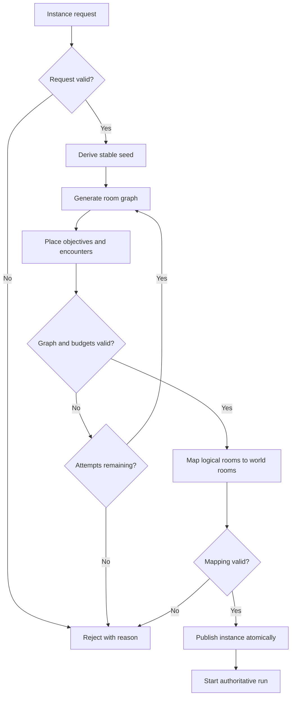

# Procedural Instances: Dungeons, Raids, Trails, and Towers

## Purpose and integration boundary

This document defines a deterministic, data-driven contract for procedural instances in AetherWorld. It complements the current procedural instance generator and does not replace CircleMUD's room/VNUM model. A generated instance is a logical layout first; the adapter that assigns rooms, exits, mobs, objects, and reset data must be separate and must validate that mapping before the instance becomes playable.

## Instance types

| Type | Typical scale | Completion rule | Special constraints |
|---|---:|---|---|
| Dungeon | 1–5 players | Defeat objective boss or complete objective chain | Branches, keys, optional rooms |
| Raid | 5–20 players | Complete boss/wing sequence | Encounter budget and checkpoints |
| Trail / Trial | 1–5 players | Reach the endpoint or complete mechanics | Time, traversal, and hazard budget |
| Tower floor | 1–5 players | Defeat guardian and activate exit | Floor progression and escalating rules |
| World-event pocket | Variable | Resolve event objective | Time-limited world-state effects |

Party sizes above are design defaults, not hard-coded engine limits. Content configuration should override them.

## Determinism contract

Every generation request must carry:
- generator version;
- world seed;
- instance template ID;
- difficulty tier;
- target depth or floor;
- content-budget profile.

For the same supported inputs and generator version, generation should produce the same logical graph. Never depend on wall-clock time, process IDs, pointer values, or unseeded random state. Version the algorithm when output compatibility intentionally changes.

Suggested seed derivation:

```text
instance_seed = hash(world_seed, template_id, difficulty_tier, depth, generator_version)
```

Use a stable, documented hash or seed-mixing function. Do not use a platform-dependent hash implementation for persisted seeds.

## Pipeline

1. Validate the request and supported bounds.
2. Derive the deterministic instance seed.
3. Select a template and room/encounter budgets.
4. Generate a logical room graph.
5. Add required objective rooms and optional branch rooms.
6. Connect rooms with corridors or explicit exits.
7. Validate graph invariants and objective reachability.
8. Place encounters, hazards, rewards, and resource nodes within budgets.
9. Validate content references and room/VNUM mapping.
10. Publish the instance atomically, or reject it without partially modifying the live world.

## Graph invariants

A generated layout is valid only when:
- it has at least one start room and one completion target;
- all mandatory rooms are reachable from the start;
- exit links are bidirectional unless an exit is explicitly one-way;
- no exit points to a missing room;
- every key/lock dependency has a reachable key or alternate route;
- encounter and reward costs remain inside configured budgets;
- room IDs are unique within the instance;
- generation has bounded attempts and bounded memory use;
- invalid or missing content data causes a clear validation failure.

Optional secret areas may be unreachable from the mandatory objective route only when a valid unlock path or discoverable traversal rule exists.

## Difficulty model

Represent difficulty as a configuration, not a collection of generator-specific conditionals. Suggested fields:

```text
tier_id
enemy_health_multiplier
enemy_damage_multiplier
encounter_budget
elite_budget
boss_budget
hazard_budget
reward_profile_id
mechanic_profile_id
optional_objective_count
```

Clamp multipliers and budgets to configured limits. The server remains authoritative for combat and rewards. Client UI may preview difficulty but must not decide encounter strength or grant loot.

## Tower progression

Each tower run records the run ID, floor, seed, generator version, difficulty profile, party snapshot, completion state, and reward transaction ID. The next floor is unlocked only after the current floor's completion transaction succeeds. Retry behavior must be idempotent so repeated completion events cannot duplicate rewards.

A floor generator should support:
- floors 1–100 as the initial content target;
- themed floor bands with biome and encounter profiles;
- periodic guardian/boss floors;
- rest or vendor floors where allowed by the ruleset;
- optional challenge modifiers;
- checkpoint and failure rules;
- a deterministic fallback template if a procedural request fails validation.

Do not silently skip a floor if generation fails. Return a visible failure and preserve the last valid checkpoint.

## Persistence and lifecycle

Keep generated layout data separate from player progression. Persist only what is needed to resume or audit a run: generator version, stable seed, template/difficulty IDs, layout or canonical layout hash, room mappings, objective state, and reward transaction identifiers.

Instance lifecycle:
- CREATED -> VALIDATED -> ACTIVE -> COMPLETED
- CREATED or VALIDATED -> REJECTED
- ACTIVE -> FAILED or ABANDONED
- COMPLETED/FAILED/ABANDONED -> ARCHIVED

Reject transitions that do not follow the state machine. Cleanup must release temporary rooms, descriptors, and instance-owned allocations without deleting persistent campaign or player data.

## Security and resource limits

All request fields are untrusted. Validate integer ranges, template IDs, and party membership on the server. Enforce maximum room count, corridor count, generation attempts, NPC count, object count, runtime, and serialized size. Rate-limit instance creation to prevent CPU or memory exhaustion. Never accept client-provided reward amounts or authoritative combat outcomes.

## Acceptance tests

At minimum, add tests for:
- identical seed and version producing the same canonical layout;
- a changed seed producing a valid layout (not necessarily a different one in every case);
- unreachable mandatory objectives being rejected;
- missing exit destinations being rejected;
- duplicate room IDs being rejected;
- budget overflow being rejected;
- invalid difficulty and depth inputs being rejected;
- generation attempt limits terminating;
- tower floor progression requiring successful completion;
- duplicate completion events not duplicating rewards;
- save/resume preserving seed, generator version, and objective state;
- malformed client input never causing a server crash.

## UML activity sketch



## Current implementation status

This file is a design and acceptance contract. It does not claim that every listed lifecycle, persistence, reward-idempotency, or security feature is implemented. Track implementation in the roadmap and only mark a feature complete after source, tests, and integration behavior have been verified.
